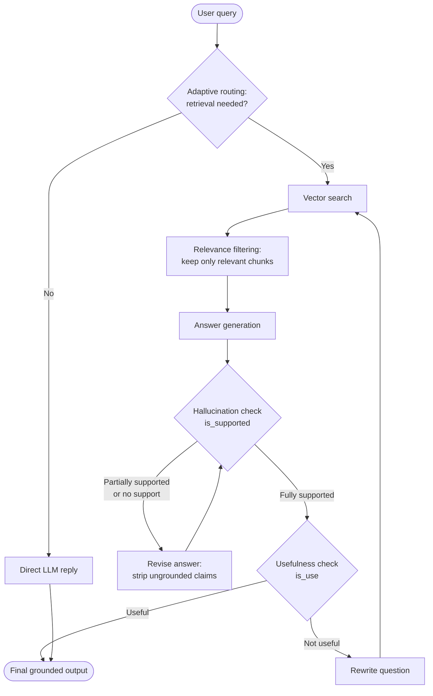

<div align="center">

#  Self-RAG: Self-Reflective Retrieval-Augmented Generation

**A LangGraph implementation of Self-RAG with a Streamlit frontend, where the LLM checks its own retrieval, evidence and answers at every step.**


</div>

---

##  About

**Self-RAG** is an advanced retrieval-augmented generation technique that enhances traditional retrieval systems by adding continuous **self-reflection** throughout text generation. Instead of blindly trusting retrieved documents, a **large language model** assesses every stage on its own:

##### Core Self-Reflection Questions
Self-RAG introduces **self-reflection** mechanisms that continuously evaluate four key questions throughout processing:
1. **Is Retrieval Necessary?** Evaluates whether external document retrieval is needed or if the query can be answered directly using general LLM knowledge.
2. **Are Documents Relevant?** Filters out noise by verifying whether each retrieved document contains useful context to answer the question.
3. **Is the Response Grounded?** Evaluates whether every factual claim in the generated answer is backed by retrieved evidence, categorizing answers into *Fully Supported*, *Partially Supported*, or *No Support*.
4. **Is the Response Useful?** Verifies whether the final grounded response actually answers the user's intent.

Implementing this adaptive architecture in **LangGraph** gives you a robust, fact-checking conversational agent that applies quality control to its own outputs.

##### Limitations of Traditional RAG
The source identifies three primary flaws with standard RAG pipelines that Self-RAG aims to fix:
* **Indiscriminate Retrieval**: Standard RAG fetches external documents for every query—even simple questions the LLM already knows from training—wasting computation and leading to unconfident answers.
* **Blind Trust**: Standard RAG blindly relies on retrieved documents based purely on semantic similarity, even when those documents fail to address the actual question.
* **Lack of Self-Verification**: Traditional RAG outputs answers without checking whether the generated response contains hallucinations or accurately resolves the query.

##### Architecture & Implementation
The tutorial builds the Self-RAG graph step-by-step using **LangGraph** and **Pydantic** structured outputs:
* **Adaptive Routing**: Directs basic queries to immediate LLM generation while sending factual/company-specific queries to vector search.
* **Relevance Filtering**: Evaluates each retrieved document individually and drops non-relevant chunks.
* **Hallucination Control (`is_supported`) & Revision**: Evaluates grounding. If claims are partially supported or ungrounded, a strict revision node re-writes the answer to strip out fabricated details until it becomes fully supported.
* **Query Rewriting (`is_use`)**: If a fully supported answer is still not useful, the system rewrites the search query with high-signal keywords, re-runs retrieval, and retries up to a set loop limit.
  
This repo builds the pipeline in seven notebooks, one capability at a time, plus a streamlined web-search notebook and Streamlit frontend.

---
## Tech Stack

| Layer | Technology |
|---|---|
| Language | Python |
| Orchestration | LangGraph, LangChain |
| Structured outputs | Pydantic (graders return typed verdicts) |
| LLM | <!-- VERIFY: e.g. OpenAI / Groq --> |
| Embeddings and vector store | <!-- VERIFY: e.g. FAISS / Chroma --> |
| Frontend | Streamlit |
| Environment | Jupyter Notebook |

---

##  Research Paper

This project is based on the Self-RAG paper:

> **Self-RAG: Learning to Retrieve, Generate, and Critique through Self-Reflection**
> Akari Asai, Zeqiu Wu, Yizhong Wang, Avirup Sil, Hannaneh Hajishirzi
> arXiv:2310.11511 [cs.CL], October 2023

| Resource | Link |
| --- | --- |
|  Paper (abstract) | [arxiv.org/abs/2310.11511](https://arxiv.org/abs/2310.11511) |
|  Paper (PDF) | [arxiv.org/pdf/2310.11511](https://arxiv.org/pdf/2310.11511) |
|  Project page | [selfrag.github.io](https://selfrag.github.io/) |
|  Authors' code | [AkariAsai/self-rag](https://github.com/AkariAsai/self-rag) |

**The paper's idea in short:** the authors train a single language model that retrieves passages **on demand**, then generates and critiques its own output using special **reflection tokens**. This makes the model controllable at inference time and improves factuality and citation accuracy compared with standard RAG.

**Reflection tokens in the paper:**

| Token | Question it answers | Possible values |
| --- | --- | --- |
| `Retrieve` | Should I retrieve passages for this? | yes / no / continue |
| `ISREL` | Is this passage relevant to the question? | relevant / irrelevant |
| `ISSUP` | Is the answer supported by the passage? | fully supported / partially supported / no support |
| `ISUSE` | Is the answer useful? | a usefulness score |

---

##  Limitations of Traditional RAG

Self-RAG is designed to fix three primary flaws of standard RAG pipelines:

| Flaw | What goes wrong |
| --- | --- |
| **Indiscriminate retrieval** | Standard RAG fetches documents for every query, even simple ones the LLM already knows. This wastes computation and can lead to unconfident answers |
| **Blind trust** | Retrieved documents are used based purely on semantic similarity, even when they fail to address the actual question |
| **No self-verification** | Answers are output without checking for hallucinations or whether they resolve the query |

---

##  The Four Self-Reflection Questions

Self-RAG continuously evaluates four questions during processing:

1. **Is retrieval necessary?** Decide whether external retrieval is needed or the query can be answered from general LLM knowledge.
2. **Are the documents relevant?** Filter noise by checking whether each retrieved document has useful context for the question.
3. **Is the response grounded?** Check that every factual claim is backed by retrieved evidence, classified as *Fully Supported*, *Partially Supported* or *No Support*.
4. **Is the response useful?** Verify that the final grounded response actually answers the user's intent.

---

##  Architecture

The Self-RAG graph is built step by step using **LangGraph** and **Pydantic** structured outputs:

| Component | Role |
| --- | --- |
| **Adaptive routing** | Sends basic queries straight to the LLM and factual or company-specific queries to vector search |
| **Relevance filtering** | Evaluates each retrieved document individually and drops non-relevant chunks |
| **Hallucination control** (`is_supported`) and **revision** (`revise_answer`) | Checks grounding. If claims are partially supported or ungrounded, a strict revision step rewrites the answer to remove fabricated details until it is fully supported |
| **Usefulness check** (`is_use`) and **query rewriting** (`rewrite_question`) | If a fully supported answer is still not useful, rewrites the search query with high-signal keywords, re-runs retrieval and retries up to a set loop limit |

### Flow diagram



---

##  Deep Dive: The Two Key Self-Reflection Loops

### 1️ The Hallucination Checker (`is_supported`) and Revision Node

The `is_supported` node is a strict verification layer that stops the LLM from outputting facts that are not in the retrieved context.

- **Evaluating grounding:** the node receives the user question, the candidate answer and the extracted context from relevant documents, then checks every factual claim against the evidence.
- **Three classifications:**

| Verdict | Meaning |
| --- | --- |
|  **Fully supported** | Every claim and figure is directly backed by the retrieved context |
|  **Partially supported** | Some claims match, but the LLM added extra, unevidenced facts from its own memory |
|  **No support** | The answer was hallucinated because the context had no matching data |

- **The revision loop (`revise_answer`):** for *Partially supported* or *No support*, execution goes to a revision node. A strict system prompt tells the LLM to strip unevidenced statements and rewrite the answer using only the provided context. The revised answer returns to `is_supported` to be re-verified. A maximum retry counter (for example 5 retries) prevents infinite loops.

### 2️ The Query Rewriter (`rewrite_question`) and Usefulness Loop (`is_use`)

A fully supported answer can still miss the user's intent, for example if the LLM picked a narrow fact or ignored the core question.

- **Usefulness evaluation (`is_use`):** after the hallucination check, the answer is checked for whether it directly and satisfactorily answers the original question.
- **Query rewriting:** if the answer is *Not useful*, control goes to `rewrite_question`. It reformulates the question into a retrieval-friendly query by removing conversational filler, keeping key entities and adding 2 to 5 high-signal keywords.
- **Adaptive search loop:** the rewritten query goes back to the vector retriever for a fresh batch of chunks, and the pipeline restarts relevance filtering, generation, the grounding check and the usefulness check. If the rewrite limit is reached without a useful answer, the system ends gracefully with a **"No Answer Found"** response.

---

##  How This Implementation Relates to the Paper

The paper **trains** a language model to produce reflection tokens. This repository takes the same idea and implements it as an **inference-time workflow**: separate LLM judgement steps, using Pydantic structured outputs, wired together as a LangGraph state graph. You get the self-reflective behaviour without fine-tuning a model.

| Paper concept | In this repository |
| --- | --- |
| `Retrieve` token | Adaptive routing node |
| `ISREL` token | Relevance filtering of each retrieved chunk |
| `ISSUP` token (fully / partially / no support) | `is_supported` node, with the same three classes, plus `revise_answer` |
| `ISUSE` token | `is_use` node, plus `rewrite_question` and the retry loop |
| Model trained with reflection tokens | Prompted LLM judges with structured outputs |

> The paper reports its results for trained 7B and 13B models. This repo does not reproduce those numbers. It demonstrates the architecture and decision logic.

---

##  Notebook

The notebooks build the graph incrementally, so every step adds one self-reflection capability.

| # | Notebook | Purpose |
| :-: | --- | --- |
| 1 | [`1_step1_self_rag.ipynb`](./1_step1_self_rag.ipynb) | Step 1 of the Self-RAG build |
| 2 | [`2_step2_self_rag.ipynb`](./2_step2_self_rag.ipynb) | Step 2 |
| 3 | [`3_step3_self_rag.ipynb`](./3_step3_self_rag.ipynb) | Step 3 |
| 4 | [`4_step4_self_rag.ipynb`](./4_step4_self_rag.ipynb) | Step 4 |
| 5 | [`5_step5_self_rag.ipynb`](./5_step5_self_rag.ipynb) | Step 5 |
| 6 | [`6_step6_self_rag.ipynb`](./6_step6_self_rag.ipynb) | Step 6 |
| 7 | [`7_step7_self_rag.ipynb`](./7_step7_self_rag.ipynb) | Step 7 |
|  | [`SelfRAG_web.ipynb`](./SelfRAG_web.ipynb) | Complete Self-RAG with the Streamlit web frontend |

The [`documents/`](./documents) folder holds the source documents used for the vector store, and [`env_template`](./env_template) is the template for your environment variables.

>  Replace the "Step N" purposes with what each notebook adds. A likely order, based on the architecture, is: adaptive routing, retrieval, relevance filtering, answer generation, hallucination check, revision loop, then usefulness check with query rewriting.

---

### Prerequisites

- Python 3.10+
- Jupyter Notebook / JupyterLab (or VS Code with the Jupyter extension)
- An API key for your LLM provider

### Installation

**1. Clone the repository**

```bash
git clone https://github.com/SyedaNaziaGit/Self_RAG.git
cd Self_RAG
```

**2. Create and activate a virtual environment**

```bash
python -m venv venv

# Windows (PowerShell)
venv\Scripts\Activate.ps1

# macOS / Linux
source venv/bin/activate
```

**3. Install the dependencies**

```bash
pip install langgraph langchain-openai faiss-cpu pydantic python-dotenv streamlit
```

If you use plain Jupyter rather than VS Code:

```bash
pip install jupyter
```

**4. Configure your environment variables**

Copy the template and fill in your key:

```bash
# Windows (PowerShell)
Copy-Item env_template .env

# macOS / Linux
cp env_template .env
```

Open `.env` and add your API key.

>  Never commit your `.env` file or API key. Make sure `.env` is in `.gitignore`.

**5. Run the notebooks in order**

Open `1_step1_self_rag.ipynb`, select the `venv` kernel, and work through the steps up to `7_step7_self_rag.ipynb`.

---

##  Running the Streamlit Frontend

1. Complete the installation steps above.
2. Open [`SelfRAG_web.ipynb`](./SelfRAG_web.ipynb) and run its cells.
3. Open the local URL Streamlit prints (usually `http://localhost:8501`).
4. Ask a question and watch the system decide whether to retrieve, filter, check and rewrite.

>  If the frontend lives in a separate `.py` file, add the exact command, for example `streamlit run app.py`.

---

##  Troubleshooting

| Problem | Fix |
| --- | --- |
| `ModuleNotFoundError` | Activate the virtual environment and re-run the `pip install` command |
| Authentication or missing API key error | Check `.env` exists in the project root and restart the notebook kernel |
| Answer always ends in "No Answer Found" | The retry limit was reached. Check that `documents/` actually contains the topic, and review the relevance filter |
| Endless revise loop | Confirm the maximum retry counter is set and that the graph's recursion limit is high enough |
| Streamlit page does not open | Check the terminal for the URL and port, and make sure nothing else is using port 8501 |
| Wrong Python in the notebook | In VS Code, choose the `venv` kernel from the kernel picker |

---

##  Key Takeaways

- Standard RAG retrieves for **every** query and trusts what it finds. Self-RAG **questions** each step.
- **Grounding checks** (fully, partially or not supported) catch hallucinations before the user sees them.
- A **usefulness check** catches answers that are correct but off-target, and **query rewriting** gives retrieval a second chance.
- **Retry limits** keep the loops safe, ending with an honest "No Answer Found" instead of a made-up answer.
- LangGraph's state graph makes each decision explicit, testable and easy to extend.

---

##  References

1. A. Asai, Z. Wu, Y. Wang, A. Sil, H. Hajishirzi. *Self-RAG: Learning to Retrieve, Generate, and Critique through Self-Reflection.* arXiv:2310.11511, 2023. [Link](https://arxiv.org/abs/2310.11511)
2. [Self-RAG project page](https://selfrag.github.io/) and [authors' code](https://github.com/AkariAsai/self-rag)
3. [LangGraph documentation](https://langchain-ai.github.io/langgraph/)
4. [Streamlit documentation](https://docs.streamlit.io/)

**Cite the paper:**

```bibtex
@article{asai2023selfrag,
  title   = {Self-RAG: Learning to Retrieve, Generate, and Critique through Self-Reflection},
  author  = {Asai, Akari and Wu, Zeqiu and Wang, Yizhong and Sil, Avirup and Hajishirzi, Hannaneh},
  journal = {arXiv preprint arXiv:2310.11511},
  year    = {2023}
}
```

---
